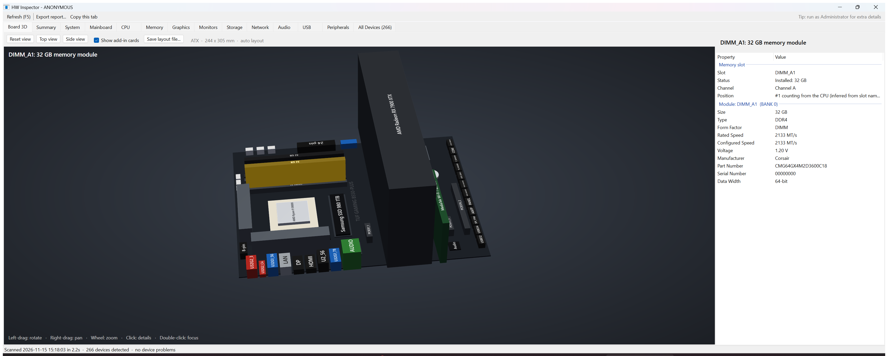

<p align="center"></p>

# HW Inspector

A small Windows hardware inspector in the spirit of CPU-Z / dxdiag, with an **interactive 3D view of your actual mainboard**.



## Features

- **Board 3D**: a 3D model of the installed mainboard built from the board's own SMBIOS data. Rotate, pan, and zoom it, then click any part (CPU, DIMM, PCIe slot, M.2, SATA, rear I/O, fan header, chipset…) to see its details.
  - Cards in PCIe slots are identified through the real PCI topology (slot bus address → bridges/switches → device).
  - NVMe drives are matched to M.2 sockets (CPU- or chipset-attached), SATA drives to ports, and memory modules to DIMM slots.
- **Info tabs**: Summary, System, Mainboard, CPU, Memory, Graphics (with real VRAM), Monitors (EDID), Storage, Network, Audio, USB, Peripherals.
- **All Devices**: a Device Manager–style tree with search, a filter for virtual devices, and highlighting for problem devices.
- Export a full text report, or copy any tab.
- Single small `.exe`. Runs on the .NET Framework 4.x that ships with Windows 10/11, so nothing else needs to be installed.

## Install

Download `HWInspector-Setup-x.y.z.exe` from **Releases** and run it. It installs per-user to
`%LOCALAPPDATA%\Programs\HW Inspector` (no admin rights), adds Start-menu and desktop shortcuts, and registers in *Settings → Apps* for uninstall.

| Command | What it does |
|---|---|
| `Setup.exe /S` | Silent install |
| `uninstall.exe /uninstall /S` | Silent uninstall |

The binaries aren't code-signed, so SmartScreen may warn on first run. Click *More info → Run anyway*.

## Build from source

You don't need Visual Studio or the .NET SDK. The C# compiler that ships with Windows (`csc.exe`, .NET Framework 4) is enough:

```bat
build.cmd
```

This produces `HWInspector.exe` and `dist\HWInspector-Setup-<version>.exe`.

| File | Purpose |
|---|---|
| `HWInspector.cs` | WMI data collection + WinForms UI |
| `Board.cs` | SMBIOS slot parser, PCI topology, board layout model (mm) |
| `Board3D.cs` | WPF `Viewport3D` renderer with picking, orbit camera, labels |
| `Setup.cs` | Self-contained installer / uninstaller (app embedded as a resource) |
| `tools/MakeIcon.cs` | Generates `app.ico` |

## Accuracy of the 3D layout

Slot, port, and header **names** and **which device is in which slot** come from real data. **Positions** follow standard ATX / mATX / ITX geometry and vendor naming conventions, so they're approximate. To match your board exactly, click **Save layout file…** in the Board 3D tab, edit the generated `layouts\<board>.txt`, and press Refresh:

```
slot PCIEX1_2 5          # put this slot at position 5 (1 = top-most)
move CHIPSET 180 235     # move a part to x,y in mm (anything sitting on it moves too)
```

## Limitations

- Temperatures, voltages, and fan RPM aren't shown. They need a kernel-level sensor driver, which WMI doesn't provide.
- Windows doesn't report which physical USB port a device is plugged into.
